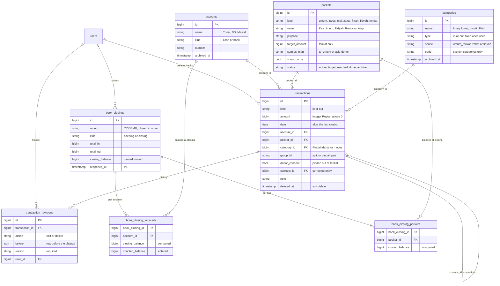

# Product requirements: Masjid platform MVP

Source of truth: the product plan v3 (11 Nov 2026) at
https://claude.ai/artifact/MKUe9CrL1d955UhM3Fmrei. This file is the in-repo copy; when they
disagree, update this file and say so in the PR.

## Product in one paragraph

One product for a mosque committee. The **bendahara** (treasurer) records cash, the **takmir**
manages the TV display, and **jamaah** (congregation) see prayer times, the iqamah countdown and
the weekly kas (cash) on a TV in the masjid. Two surfaces:

| Surface     | Who uses it                 | Size                 | Route        |
| ----------- | --------------------------- | -------------------- | ------------ |
| Admin panel | Pengurus (committee) on HP  | 390 px, mobile first | `/`          |
| TV display  | Jamaah, read only, no login | 1920×1080, offline   | `/tv`        |

Single-tenant: one installation (API, database, admin panel and TV) serves one mosque, so tables
carry no `mosque_id`. Serving many mosques from one installation (SaaS) is a P2 change.

## Goals

- Sign-up to a working TV screen in under 15 minutes.
- Bendahara records a transaction in under 30 seconds on a phone.
- TV switches normal → adzan → iqamah → sholat → normal on its own every waktu, including Jumat.
- TV keeps showing correct times with the internet down.

## Not in MVP

- Online donation, QRIS payment gateway, billing.
- Public web report pages, PDF export, warga database.
- TV pairing codes, native apps, multi-language.

## Scope

Priority rules: **P0** the mosque cannot run without it · **P1** build once 3 pilot mosques use
P0 weekly · **P2** growth and monetisation.

| Area            | P0 · MVP                                                                                                  | P1 · v1.1                                                                           | P2 · later                               |
| --------------- | --------------------------------------------------------------------------------------------------------- | ----------------------------------------------------------------------------------- | ---------------------------------------- |
| TV display      | Normal layout, adzan, iqamah countdown, mode sholat, mode Jumat, slides, quotes, running text, kas header | Ramadhan mode, theme/portrait layouts                                               | Tarhim audio, hari besar & puasa sunnah  |
| Screens         | URL `/tv`, heartbeat auto-register, online/offline, reload, force mode, offline cache              | Content per screen schedule                                                         | Remote screenshot monitoring             |
| Prayer times    | Kemenag calc on device, ±10 min correction, Imsak, date overrides, Hijri ±2                               | Imsakiyah Ramadhan                                                                  | —                                        |
| Content         | Slides, running text, built-in quote list, petugas Jumat                                                  | Quote manager, agenda/kajian, content date ranges                                   | —                                        |
| Keuangan        | Kas (kantong): built-in Kas Umum, Zakat Mal, Zakat Fitrah, Fidyah; earmarked (terikat) kas with target, close a finished kas into Kas Umum. Accounts: Tunai + bank with opening balance. Transactions carry an account and a kas, split income, pindah dana antar kas with syariah rules, setor/tarik antar akun, categories with archive, edit reason, tutup buku with cash count, TV rotates kas | Reports + PDF with signatures, rekening/QRIS info, donor list, reopen tutup buku | Online donation   |
| People & access | Login email/HP + password, 3 roles, invite, deactivate, activity log                                      | OTP WhatsApp, full audit log page                                                   | Warga database, super-admin SaaS console |
| Public web      | —                                                                                                         | Pages: Beranda, Laporan kas, Jadwal, Kontak                                         | Custom domain                            |

## Roles and permissions

Accounts are created by a super admin; there is no self sign-up after the mosque is registered.
At least one super admin must stay active. Jamaah never log in.

| Menu                   | Super admin | Takmir | Bendahara |
| ---------------------- | ----------- | ------ | --------- |
| Beranda & aktivitas    | Edit        | View   | View      |
| Profil masjid          | Edit        | View   | —         |
| Pengguna               | Edit        | —      | —         |
| Layar TV               | Edit        | Edit   | —         |
| Waktu sholat & Hijriah | Edit        | Edit   | —         |
| Iqamah, adzan & alarm  | Edit        | Edit   | —         |
| Slide & running text   | Edit        | Edit   | —         |
| Petugas Jumat          | Edit        | Edit   | —         |
| Keuangan & transaksi   | Edit        | View   | Edit      |
| Kas: buat, ubah, selesaikan | Edit   | View   | Edit      |
| Pindah dana & setor/tarik | Edit     | —      | Edit      |
| Kategori & tutup buku  | Edit        | —      | Edit      |

Edit = can change · View = read only · — = menu hidden (not just disabled).

## Settled decisions

| Decision                               | Rule                                                                                                                                  |
| -------------------------------------- | ------------------------------------------------------------------------------------------------------------------------------------- |
| TV opens a URL, no pairing             | A TV opens `/tv` (optional `?layar=teras`) and registers itself by heartbeat. Admin can rename or hide unknown screens.        |
| Money lives in kas, never mixed        | Every transaction belongs to one kas (kantong). Kas Umum, Zakat Mal, Zakat Fitrah and Fidyah are built into the code with their rules and seeded once; pengurus only add Terikat kas (e.g. Renovasi Atap). |
| Zakat and fidyah are closed both ways  | Zakat comes in only from muzakki and goes out only to one of the 8 asnaf (QS At-Taubah 60); fidyah goes out only to fakir or miskin. No Pindah dana into or out of these kas and no custom categories for them. Hidden from the TV by default. |
| Amil cap and fitrah deadline warn      | Amil spending above 1/8 of a zakat kas's income this Hijri year shows a warning. Zakat Fitrah still holding money from 1 Syawal shows a warning. |
| Out of scope                           | Wakaf, bank interest (dana non-halal) and zakat-management legal status (UPZ / LAZ) are not handled by the app. |
| Earmarked money moves only with consent | Pindah dana from a terikat kas needs a reason and a ticked "donatur sudah merelakan". Kas Umum may top up a terikat kas freely. |
| Finished goal → remainder to Kas Umum  | Every terikat kas states its "rencana sisa dana" when created. "Dialihkan ke Kas Umum" moves the remainder in one confirmed step when the program is done; "Minta persetujuan donatur dulu" needs a ticked consent and a note. |
| No account or kas goes below zero      | An expense or Pindah dana larger than the account or kas balance is blocked. |
| Money sits in accounts                 | Accounts are where money is: Tunai (the box) and each bank account. Every transaction has an account and a kas; the total of all accounts equals the total of all kas. Pembukuan starts with an opening balance per account, split over kas, which is never pemasukan. |
| Only two kinds: in and out             | No transfer kind. Setor tunai, pindah antar kas and "Selesaikan program" are a linked pair: an out row on the source and an in row on the destination, same group_id, system category "Pindah dana". The pair is created, edited and deleted together and left out of the pemasukan / pengeluaran totals. |
| Kas header is static per kas           | 4 columns (saldo awal, pemasukan, pengeluaran, saldo akhir), never a scrolling ticker. With several kas marked "tampil di TV", the header shows one kas at a time and switches every 6 s. |
| TV columns add up per kas (11 Nov)     | On the TV header, Pindah dana into or out of a kas counts as that kas's pemasukan / pengeluaran, so saldo awal + pemasukan − pengeluaran = saldo akhir for each kas. The mosque's own totals (Keuangan, tutup buku) still leave Pindah dana out. |
| Tutup buku in order, after a count     | Months close one after another. The bendahara enters the counted cash and bank balance per account; a difference is recorded before closing. Reopening the latest closing (super admin, with reason) is P1. |
| Categories archive, not delete         | A category can be deleted only with 0 transactions; otherwise it is archived and hidden from the form. Archived ones can be restored. |
| Edits need a reason, months get locked | Editing or deleting a transaction requires a reason, keeps the old values and marks it "Diedit". Tutup buku locks the whole month.    |
| What an edit may change (11 Nov)       | The kind (pemasukan / pengeluaran) never changes, and a split keeps its number of kas; changing either means deleting and recording again. A Pindah dana pair is edited through its own form. |
| Archive and restore (11 Nov)           | Accounts and terikat kas are archived only at Rp 0 (the last cash account always stays) and can be restored. "Selesaikan program" archives the kas after moving its remainder. |
| Zakat Fitrah warning months (11 Nov)   | Zakat Fitrah still holding money warns in every Hijri month except Sya'ban and Ramadan, the collecting season. |
| Closed months are fixed by correction  | A mistake in a closed month is fixed with a correction entry in the current month that points to the original; the original stays.    |
| Prayer times computed on the device    | Kemenag method with per-waktu correction ±10 min; no external API, so the TV works offline.                                           |
| Amount input must clear cleanly        | Select all on focus; confirm large amounts. (A competitor's mask appended digits and saved Rp 1.000.015.000.)                         |
| No shared default password             | Each user gets their own initial password from a super admin (invite or reset link once the API has them).                            |
| Opening balance is set once (11 Nov)   | "Mulai pembukuan" records the opening balance per account, split over kas, as an opening tutup buku, not as a transaction. (The Kas simulation's editable "Saldo awal" transaction is not used.) |
| Hijri dates on the server (11 Nov)     | The amil cap (per Hijri year) and the fitrah deadline (1 Syawal) use the Umm al-Qura calendar in Go plus the mosque's Hijri correction from Waktu sholat. |
| A kas may be paid from any account (11 Nov) | Zakat that arrived by bank may be paid out in cash: kas and account are tracked apart, and neither may go below Rp 0. |
| Receipt photos in the database (11 Nov) | Photos are resized in the browser to ≤ 1 MB and stored like slide images; object storage comes with E1-04. |
| Amount limits (11 Nov)                 | At most Rp 10.000.000.000 per transaction; the form asks to confirm amounts above Rp 10.000.000. |
| Soft delete for money                  | Soft-delete everywhere money is involved; block deleting anything still in use.                                                       |
| Hide empty fields                      | Empty optional fields never render.                                                                                                   |

## Functional requirements

Each module maps to an epic in [backlog.md](./backlog.md). Screens are in
[../design/screens.md](../design/screens.md).

### Akun & pengguna (E2)

- Login with email or HP + password, "Ingat saya". "Lupa password?" tells the user to ask a super
  admin, who resets it from Pengguna.
- Super admin adds a user: nama, nomor HP (required, login), email (optional), peran and an
  initial password they hand over in person.
- Per user: ubah data (nama, nomor HP, email), ubah peran, atur ulang password (super admin types
  the new one), nonaktifkan / aktifkan kembali. Role change, reset and deactivation end the user's
  sessions.
- Every role can change their own password from "Akun saya" (Ganti password), with the current
  one; the session stays logged in.
- **Built to the current API (Nov 2026), not the mockup:** the API has no invite or reset-link
  flow and no `disabled_at` (so no "Nonaktif sejak …"). `GET /auth/profile` gives every role
  its name on Home. Login reads the public
  `/api/public/v1/mosque-profile` and logo, falling back to "Masjid Digital" and the placeholder
  mark until they are saved. Revisit when those endpoints exist.
- Activity log records who did what; Beranda shows the latest 4.
- **Rule:** minimum one active super admin; the last one cannot be deactivated or demoted.

### Profil masjid (E3)

- Logo PNG/JPG/SVG ≤ 2 MB, cropped square.
- Nama, alamat, kontak pengurus, map pin, koordinat, zona waktu.
- "Simpan dan kirim ke layar" pushes to every TV.
- **Rule:** coordinates drive prayer times; changing them shows the new times before saving.

### Waktu sholat & Hijriah (E4)

- Method Kemenag RI (Subuh 20°, Isya 18°); location from profil.
- Correction per waktu with − / + steppers; Imsak = 10 min before Subuh.
- 7-day preview; override a single date (e.g. Jumat Dzuhur 11:58).
- Hijri correction −2..+2 with an effective date; TV shows the result.
- **Rule:** correction range −10..+10 minutes.

### Iqamah, adzan & alarm (E5)

- Per waktu: iqamah and mode sholat duration; Jumat iqamah "setelah khutbah".
- Adzan screen duration (default 4 min).
- Mode sholat display: teks redup or gelap total.
- Alarm at adzan and in the last 10 s before iqamah; sound beep or bel; volume; "Uji bunyi di
  semua layar".
- Petugas Jumat per date: khatib, imam, muadzin, tema khutbah.
- **Rule:** iqamah 1–30 min, mode sholat 5–30 min (Jumat up to 60).

### Slide & running text (E6)

- Upload several images at once, JPG/PNG/WebP ≤ 5 MB, 16:9 suggested.
- Per slide: judul (caption), keterangan, durasi, tampil di (all screens or one), aktif/nonaktif;
  drag to reorder.
- Running text ≤ 200 characters, "Tandai penting" shows first, drag to reorder, speed
  lambat/sedang/cepat, live preview.
- **Rule:** quotes rotate from a built-in ayat/hadits list in MVP.

### Keuangan (E7)

UI reference: the Kas simulation (https://claude.ai/artifact/GjDxT3BL6iHv3dk6HMgP7m). It supersedes
the old Keuangan, Transaksi and Kategori mockups.

- Kas chips; per kas: balance card with type badge and purpose, masuk & keluar hari ini;
  + Pemasukan / − Pengeluaran / Pindah dana. On a zakat or fidyah kas, Pindah dana is replaced by
  "Dana zakat tidak bisa dipindah ke kas lain. Salurkan lewat pengeluaran."
- List with filter Semua / Masuk / Keluar / Pindah, month, search; edited rows tagged "Diedit";
  "Tampilkan transaksi yang dihapus".
- Form: Pemasukan / Pengeluaran, nominal, kas (purpose shown under it), akun (default Tunai),
  tanggal, kategori (by kas kind) + Kelola kategori, keterangan, foto bukti; "Bagi ke beberapa
  kas" for split income.
- Pindah dana: "Pindah dana bukan pemasukan atau pengeluaran masjid." One form with dari (kas +
  akun, with saldo), ke (kas + akun), nominal, tanggal, alasan; saved as an out + in pair. Setor
  tunai is the same form with the same kas on both sides.
- Kas list: "N kas aktif", + Tambah kas; each kas with type badge, balance, TV visibility. Built-in
  kas are locked. Kas baru / Ubah kas (Terikat only): nama, peruntukan, target, rencana sisa dana,
  tampil di TV; the type never changes; archive only at Rp 0.
- Target: progress bar, "Target tercapai"; "Selesaikan program" moves the remainder to Kas Umum
  and archives the kas.
- Akun: Tunai plus bank accounts with balances. "Mulai pembukuan" sets the start month and the
  opening balance per account, split over kas, once.
- "Tampilkan di layar TV" and the period shown (hari ini / minggu ini / bulan ini).
- Tutup buku per month, in order: per account the computed balance next to the counted one; kas
  balances are kept with the closing.
- **Rule:** blocked: Pindah dana into or out of a zakat or fidyah kas; anything that takes an
  account or kas below Rp 0. From terikat: reason + "donatur sudah merelakan".
- **Rule:** edit/delete needs a reason; closed months are read only and fixed by a correction
  entry in the current month. Nothing can be dated before the start of pembukuan or after today.
- **Rule:** balances and totals are computed in the usecase from the last tutup buku plus the
  transactions after it; queries never sum.

### Kategori (E7)

- Tabs Pemasukan and Pengeluaran, scoped by kas kind (umum/terikat, zakat, fidyah); each row shows
  its transaction count.
- System categories in code: zakat income (zakat mal, zakat fitrah), zakat expense (fakir, miskin,
  amil, mualaf, riqab, gharimin, fisabilillah, ibnu sabil), fidyah income (fidyah), fidyah expense
  (fakir, miskin), and "Pindah dana".
- Pengurus add their own categories only for Kas Umum and Terikat kas. Rename any own category;
  delete only when unused; archive when used, with Pulihkan.
- **Rule:** asnaf categories can be hidden but not renamed or deleted.
- **Defaults for Umum / Terikat:** in: Kotak amal harian, Infaq Jumat, Infaq transfer / QRIS,
  Donasi program; out: Listrik, Air, Kebersihan, Kegiatan, Honor.

### TV display (E8)

- **Normal:** header (logo, nama, alamat) + 4-column kas; date Masehi + Hijri, big clock, zone;
  quote card; slide area with caption and dots; countdown "Menuju {waktu}"; 7 tiles, next one
  gold with "BERIKUTNYA"; INFO running text.
- **Adzan:** "Telah masuk waktu {waktu}", time, iqamah in N min.
- **Iqamah:** countdown, "dari N menit", reminders (shaf, HP), imam and muadzin.
- **Sholat:** dim text or black, small clock.
- **Jumat:** Sholat Jumat time, adzan countdown, khatib/imam/muadzin, tema, khutbah reminder.
- **Rule:** mode order per waktu is normal → adzan → iqamah → sholat → normal. Alarm needs one
  tap on the TV after boot to unlock audio.

### Layar TV operations (E9)

- Admin shows the URL with Salin and a QR code, plus the `?layar=` tip.
- Each screen: name, last seen, version, Online/Offline, Paksa mode tampilan, Reload, Ganti nama,
  Blokir. "Muat ulang semua" reloads every online screen (e.g. after a deploy).
- A new screen appears with a BARU badge: "Beri nama" (prefilled from `?layar=`) or "Bukan layar
  kita" (blocks it).
- Blocked screens are hidden; "Lihat layar diblokir (N)" lists them with "Buka blokir" to undo a
  wrong block. Only valid screens show in the list and on Home.
- The TV holds one live connection (SSE). Being connected is being online; its forced mode,
  content refreshes and commands (reload, uji bunyi) come down it. Saving anything the TV shows
  refreshes every TV within seconds; the 5-minute aligned refresh stays as the fallback.
- **Rule:** offline for > 2 min = Offline; the TV keeps running from what it has and says so. It
  reloads itself after an error only once the network is back.
- **Rule:** a forced mode lasts until the mosque's next midnight, then the screen follows its
  schedule again. A forced mode also silences the alarm.
- **Rule:** a device gets its database row once, on its first connect (at most 50 screens). Last
  seen and the app version live in the cache (Redis in production), never written per minute.
- **Rule:** a blocked TV is refused on connect and checks back every 5 minutes, so an unblocked one
  returns by itself.

## Data model

Single-tenant: no `mosque_id`. Money is **integer Rupiah**; balances are computed in the usecase,
never stored. A tutup buku keeps the totals of its month as of closing; the next balances start
from there.

| Entity                 | Key fields                                                                                                                                                                        |
| ---------------------- | --------------------------------------------------------------------------------------------------------------------------------------------------------------------------------- |
| mosque profile         | name, address, contact, logo_url, lat, lng, timezone, prayer_method, hijri_offset, hijri_offset_from                                                                        |
| `users`                | name, email/phone, password_hash, role (super_admin / takmir / bendahara), status, deactivated_at                                                                                 |
| `prayer_settings`      | per waktu: correction_min (−10..10), iqamah_min (1..30), sholat_min (5..30, Jumat ≤60); imsak_offset, adzan_display_min, sholat_display (dim / black), alarm flags, sound, volume |
| `prayer_overrides`     | date, waktu, time, note                                                                                                                                                           |
| `friday_duty`          | date, khatib, imam, muadzin, theme                                                                                                                                                |
| `slides`               | image_url, title, caption, duration_s, screen_ids (null = all), active, sort                                                                                                      |
| `running_texts`        | text (≤200), important, sort; mosque-level scroll_speed                                                                                                                           |
| `accounts`             | name, kind (cash / bank), number, archived_at |
| `pockets` (kas)        | kind (umum / zakat_mal / zakat_fitrah / fidyah / terikat; rules per kind in code), name, purpose, target_amount, surplus_plan (to_umum / ask_donor), show_on_tv, status (active / target_reached / done / archived), opened_at. One row per built-in kind is seeded; only terikat rows are created by users |
| `categories`           | name, type (in / out, fixed once used), scope (umum_terikat / zakat / fidyah), code (system categories: asnaf, zakat, fidyah, pindah), archived_at |
| `transactions`         | kind (in / out only), amount > 0, date, account_id, pocket_id, category_id, group_id (links the rows of one split or one pindah), donor_consent (pindah out of terikat), corrects_id, note, donor_note, photo, created_by, updated_by, deleted_at, deleted_by |
| `transaction_revisions`| transaction_id, action (edit / delete), before (old values), reason, user_id, created_at |
| `book_closings`        | month, kind (opening / closing), total_in, total_out, closing_balance, closed_by, closed_at, reopened_at, reopen_reason |
| `book_closing_accounts`| book_closing_id, account_id, closing_balance (computed), counted_balance (entered) |
| `book_closing_pockets` | book_closing_id, pocket_id, closing_balance (computed, carried forward per kas) |
| `screens`              | device_id, name, name_hint, user_agent, forced_mode, forced_until, blocked_at, first_seen_at (last seen and app version in the cache)                                                                                                                 |
| `activity_logs`        | user_id, action, entity, summary, created_at                                                                                                                                      |

### Keuangan (E7) data model

Single-entry, cash-basis bookkeeping on two axes. The **account** says where the money physically
is (Tunai, bank). The **kas** (`pockets` in code) says whose money it is and what it may be spent
on (Umum, Zakat, Renovasi). Every transaction has both, so every account balance and every kas
balance can be computed, and the two always add up to the same total.

What each kind does:

| Kind                   | Accounts         | Kas             | Totals               |
| ---------------------- | ---------------- | --------------- | -------------------- |
| `in`                   | + on its account | + on its kas    | pemasukan            |
| `out`                  | − on its account | − on its kas    | pengeluaran          |
| `out` + `in` (Pindah dana) | One out row on the source, one in row on the destination, same `group_id`, system category "Pindah dana". Setor tunai = same kas, different account. Pindah antar kas = same account, different kas. | | not counted |

Example: the same money seen by kas.

| Day | Entry                                                       | Account | Kas Umum  | Zakat Mal | Renovasi Atap (target 3.000.000) |
| --- | ----------------------------------------------------------- | ------- | --------- | --------- | -------------------------------- |
| Fri | Infaq Jumat in the box                                      | Tunai   | +2.000.000 |          |                                  |
| Sat | Rp 1.000.000 by QRIS: zakat 600.000 + renovasi 400.000 (split) | Bank |           | +600.000  | +400.000                         |
| Sun | Renovasi donations reach the target                         | Bank    |           |           | +2.700.000                       |
| Mon | Zakat to 3 fakir (expense, asnaf Fakir)                     | Tunai   |           | −600.000  |                                  |
| Tue | Roof contractor paid                                        | Bank    |           |           | −2.850.000                       |
| Wed | "Selesaikan program": remainder to Kas Umum                 | Bank    | +250.000  |           | −250.000 → archived              |
|     | **Balance**                                                 |         | **2.250.000** | **0** | **0**                            |

Rules the usecase enforces:

- **Transactions:** amount > 0 and ≤ Rp 10.000.000.000; category type equals the kind and the
  category's scope matches the kas kind; the date is not in the future, after the last tutup buku
  and not before the opening; no account and no kas goes below Rp 0.
- **Pindah dana:** never into or out of zakat or fidyah; out of terikat needs a reason and donor
  consent; Kas Umum → terikat is free. The pair is saved, edited and deleted together.
- **Edit or delete:** in an open month, with a reason. The revision and the change are written in
  one database transaction (`database.Transactor.WithTx`).
- **Closed months:** never changed; fixed by a new entry dated today with `corrects_id`.
- **Tutup buku:** only a month that has ended, and only after the previous one is closed. Each
  account's counted balance must equal its computed balance, or the difference is recorded first.

## Stack

The plan suggested Laravel/NestJS + Next.js. **This repo uses Go (Echo) for the API and Vite +
React for the admin panel and TV display**; that choice supersedes the suggestion.

- Prayer times: the `adhan` JS library with Kemenag params (Subuh 20°, Isya 18°), the same code on
  server and TV.
- Realtime: SSE push with 60 s polling fallback.
- TV route is a PWA: images cached by service worker, clock offset synced to server time.

## Non-functional

- TV works 24 h with no internet: times computed locally, images cached.
- Runs on a cheap Android TV box: TV payload under 50 KB, images resized to 1920 px.
- Permission tests per role; soft delete everywhere money is involved.
- WIB / WITA / WIT from the mosque's timezone.
- **UI copy is Bahasa Indonesia.** Code, comments and docs are English.

## Pilot metrics

- 3 of 3 pilot mosques run the TV every day for 2 weeks.
- 0 wrong prayer times reported after correction is set.
- 0 kas mismatches between the TV header and the bendahara's own count.
- At least 5 transactions per mosque per week.

## Open questions

- Team: 1 API + 1 UI developer, or solo?
- Which 3 mosques pilot, and who is the bendahara contact at each?
- Pricing: free during pilot, then per mosque per month?
- Does the TV kas header show the whole kas or only the selected period's movement?
- Who fills petugas Jumat each week, takmir or sekretaris?
